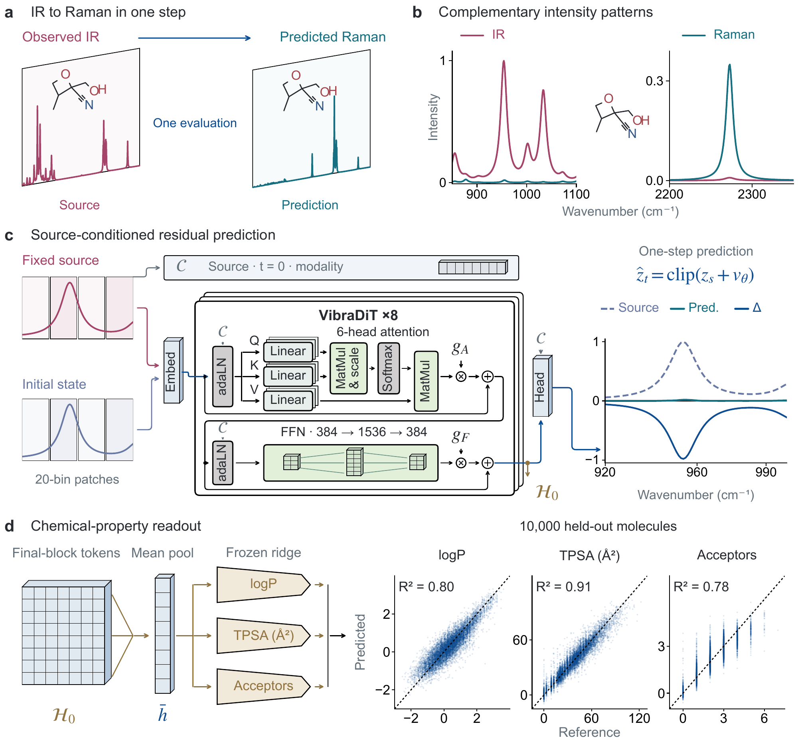
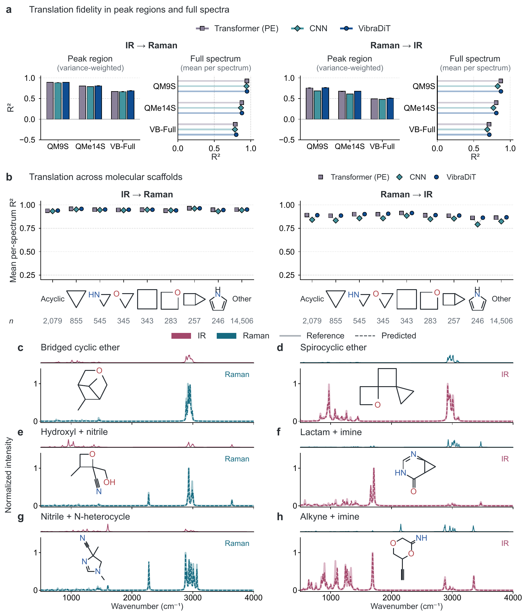
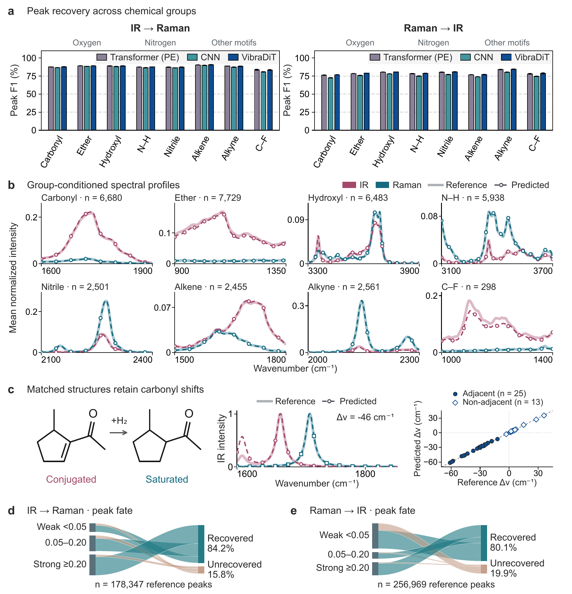
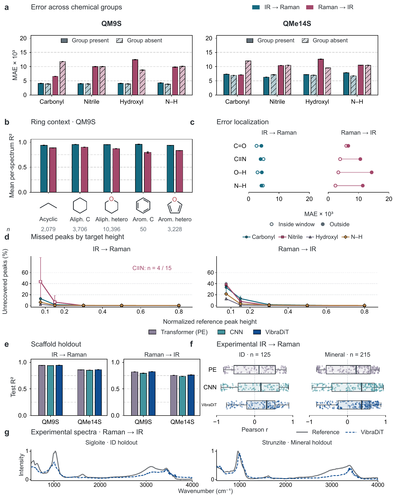
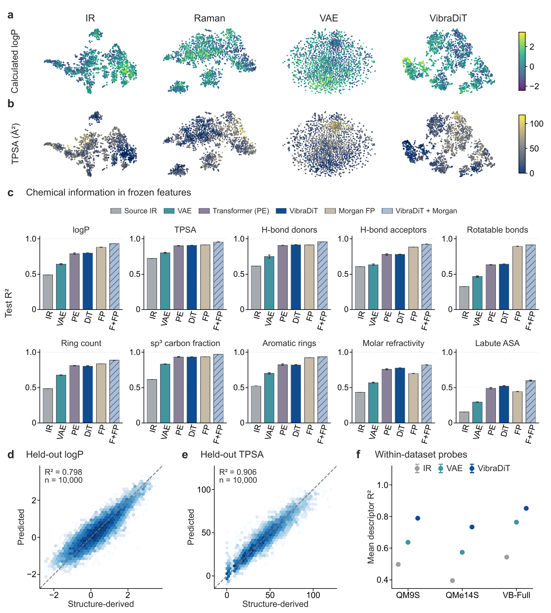

# VibraDiT

**One-step translation between infrared and Raman spectra, with reusable molecular features.**

VibraDiT predicts a complementary vibrational spectrum from an observed spectrum.
Ordered spectral patches pass through eight adaptive Transformer blocks in a
single network evaluation. The final tokens also provide frozen features for
molecular-descriptor prediction. Molecular structures are not model inputs.

[](figures/Figure1.pdf)

**[Installation and usage](#quick-start) · [Main figures](#main-figures) ·
[Data](docs/data.md) · [Reproduction](docs/reproduction.md) ·
[Results](results/benchmark.csv)**

This repository contains the current **one-step VibraDiT** implementation
and paper figures.
The previous multi-step implementation and manuscript remain available in the
[archived version](https://github.com/jiaqingxie/VibraDiT/tree/archive/spectraflow-20261003).

## Quick start

Use Python 3.10 or newer and a PyTorch installation suitable for your CPU or GPU.

```bash
git clone https://github.com/jiaqingxie/VibraDiT.git
cd VibraDiT
python -m venv .venv
source .venv/bin/activate
pip install -e .
```

The package includes VibraDiT, the position-aware Transformer baseline and the
1D CNN baseline. Processed datasets and pretrained weights are **not bundled**;
the [data guide](docs/data.md) specifies the required arrays and published splits.

Train one of the 168 recorded dataset/model/direction/seed configurations:

```bash
vibradit list-tasks

vibradit verify-data --task qm9s_vibradit_ir_seed0 --data-root /path/to/data

vibradit train --task qm9s_vibradit_ir_seed0 \
  --data-root /path/to/data --output-dir runs/qm9s_vibradit_ir_seed0 --device cuda
```

Predict from an `N × L` NumPy array of spectra in their original spectral order.
The checkpoint determines the translation direction. This example also exports
the frozen final-block features from the same evaluation:

```bash
vibradit predict --checkpoint runs/qm9s_vibradit_ir_seed0/best.pt \
  --input observed_ir.npy --output outputs/predicted_raman.npy \
  --features-output outputs/features.npy --device cuda
```

Evaluate the selected checkpoint on its recorded test partition:

```bash
vibradit evaluate --task qm9s_vibradit_ir_seed0 \
  --checkpoint runs/qm9s_vibradit_ir_seed0/best.pt \
  --data-root /path/to/data --output-dir outputs/qm9s_test --device cuda
```

Prediction and evaluation also support `--device cpu`. See the
[reproduction guide](docs/reproduction.md) for training settings, checkpoint
selection, descriptor analysis and the numerical checks performed during this
code reorganization.

## Main figures

These are the manuscript's five main figures. The PDFs are copied unchanged;
the PNGs are browser previews. [Checksums](figures/manifest.json) and
[numerical source tables](figures/source_data/) accompany them.

### Figure 1 · Model and molecular features

The overview above shows one-step prediction, source conditioning and frozen
feature extraction. [Download PDF](figures/Figure1.pdf).

### Figure 2 · Spectral reconstruction

[](figures/Figure2.pdf)

Peak-region and full-spectrum accuracy, scaffold strata and fixed molecular
examples. [PDF](figures/Figure2.pdf) · [Source data](figures/source_data/Figure2/)

### Figure 3 · Chemical bands and frequency shifts

[](figures/Figure3.pdf)

Functional-group comparisons, carbonyl frequency shifts and recovery of target
peaks with different source-signal strengths.
[PDF](figures/Figure3.pdf) · [Source data](figures/source_data/Figure3/)

### Figure 4 · Error analysis and held-out groups

[](figures/Figure4.pdf)

Errors by molecular group and peak height, scaffold holdouts and measured
mineral spectra. [PDF](figures/Figure4.pdf) · [Source data](figures/source_data/Figure4/)

### Figure 5 · Molecular-descriptor prediction

[](figures/Figure5.pdf)

Representation visualizations, all ten descriptors and all six feature sets,
with the original panel arrangement retained.
[PDF](figures/Figure5.pdf) · [Source data](figures/source_data/Figure5/)

## Repository layout

```text
src/vibradit/    model, baselines, training, inference and analysis
configs/        168 paper tasks and seven fixed split files
figures/        the five main figures and their numerical source tables
results/        seed-level scores, summaries and checkpoint metadata
docs/           data, reproduction and version notes
tests/          training/inference and protocol checks
```

The primary comparison covers three computed-spectrum collections, two
translation directions and four seeds. VibraDiT has higher mean per-spectrum
R² than both baselines in all six settings; MAE comparisons with the Transformer
are mixed. Scaffold and RRUFF results are included in the
[complete seed-level table](results/benchmark.csv).

## Development

```bash
pip install -e '.[analysis,dev]'
pytest -q
ruff check src tests
```

The manuscript is under preparation. A publication citation will be added when
available. [Version history](docs/history.md) records how this release relates
to the earlier SpectraFlow code.
